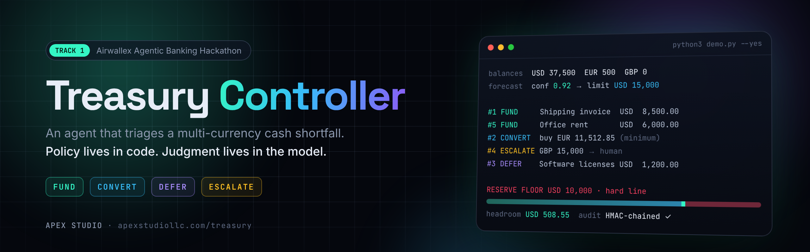

<p align="center">
  <a href="https://apexstudiollc.com/treasury/"></a>
</p>

<p align="center">
  <a href="https://apexstudiollc.com/treasury/"><b>Website</b></a> ·
  <a href="https://98-81-148-190.sslip.io/"><b>Live demo</b></a> ·
  <a href="https://youtu.be/Fx6LF039KRQ"><b>Video walkthrough</b></a> ·
  <a href="#quick-start"><b>Quick start</b></a> ·
  <a href="#security-and-compliance"><b>Security</b></a>
</p>

<p align="center">
  
  
  
  
  <a href="LICENSE"></a>
</p>

---

**Treasury Controller** is an agent that triages a cash shortfall for a small business. Five obligations
fall due across USD, EUR and GBP within 72 hours, and cash above a USD 10,000 reserve floor covers only
about 60% of them. The agent **funds, converts, defers and escalates**, each for a different stated
reason. It then adapts when a customer email undermines its receipt forecast and when a deposit lands
mid-cycle. It executes one FX conversion and one supplier transfer over the Airwallex REST API and
confirms the reserve against reconciled balances.

> **Policy lives in code; judgment lives in the model.** The model reads the customer email and explains
> exceptions. Code owns every amount, limit, reserve, validation, duplicate check and state transition.

Built by [Apex Studio](https://apexstudiollc.com/treasury/) for Track 1 of the Airwallex Agentic Banking Hackathon.

## Watch the demo

<p align="center">
  <a href="https://youtu.be/Fx6LF039KRQ">
    
  </a>
  <br>
  <sub>▶ <a href="https://youtu.be/Fx6LF039KRQ">Treasury Controller live demo</a>: all four acts, end to end</sub>
</p>

### Try it in your browser

The [live dashboard](https://98-81-148-190.sslip.io/) runs the same agent against the offline mock
sandbox, with fake money only. Sign in with any demo approver:

| Approver id | PIN | Role | Signs |
|---|---|---|---|
| `sam.treasury` | `fx-approve-42` | Treasury approver | FX conversions |
| `dana.controller` | `release-funds-7` | Finance controller | Policy exceptions and failed payouts |
| `casey.compliance` | `screen-names-11` | Compliance officer | Screening reviews |

Run **Act 1 · Triage**, then the email shock and the deposit, then sign the cards and execute.

## Highlights

| | |
|---|---|
| 🧮 **Four decisions, four reasons** | Fund what stops operations, convert only the minimum FX, defer the cheapest bill, escalate what breaches policy. Each decision carries its rule code. |
| 📉 **Confidence-gated autonomy** | Bank history plus invoice status set forecast confidence, which sets the autonomous FX limit. An email can only *lower* it, so a prompt injection can never widen the agent's authority. |
| 🧱 **Reserve floor as a hard line** | Planning never draws below it; execution re-checks it against the real quote, net of every commitment. |
| ✍️ **Digest-bound approvals** | Each approval card is a SHA-256 digest of the action, amount, counterparty, destination, ceiling, evidence and expiry. Cards are single use and are superseded when the evidence changes. |
| 🔗 **Tamper-evident audit log** | Append-only and HMAC-chained, with triggers that refuse UPDATE and DELETE. `manage.py verify-audit` catches a rewritten amount. |
| 🔁 **Never pays twice** | A request_id is persisted before every write, ambiguous failures are looked up rather than retried blindly, and a unique index enforces one live payout per invoice. |

## Quick start

Python 3.11+, standard library only at runtime.

```bash
git clone https://github.com/coldrazer/treasury-controller
cd treasury-controller

python3 demo.py                    # offline: a local mock of the Airwallex sandbox, no credentials
python3 demo.py --yes              # the demo approver signs the bound card (non-interactive)
python3 demo.py --yes --pace 1.2   # slower beats for screen recording
python3 webui.py --mode mock       # the dashboard on http://127.0.0.1:8080
```

Tests and static checks (dev-only dependencies):

```bash
python3 -m venv .venv && .venv/bin/pip install -r requirements-dev.txt
.venv/bin/python -m pytest      # rules, client, approvals, ledger, four acts, failure paths, controls, public demo
.venv/bin/python -m pyflakes *.py tests/*.py
.venv/bin/python -m bandit -q -r . -x ./tests,./.venv,./__pycache__
```

Without `--yes` the demo stops at the approval card and asks for an approver id, passcode and the
card's code. Mock runs enrol the three demo approvers above into a throwaway database (fake money only).

### Against the real Airwallex sandbox

```bash
cp .env.example .env && chmod 600 .env   # fill AWX_CLIENT_ID / AWX_API_KEY (Account > Developer > API keys)
python3 manage.py gen-key                # → TREASURY_AUDIT_KEY (keep it in a secrets manager)
python3 smoke_live.py                    # read-only: login, balances, Global Accounts, one rate

# one-time: people and the verified payee account
python3 manage.py add-approver --bootstrap --id dana.controller --name "Dana Reyes" --roles finance_controller
python3 manage.py add-approver --by dana.controller --id sam.treasury --name "Sam Ortiz" --roles treasury_approver
python3 manage.py pin-payee --by dana.controller --obligation 2 --reason "IBAN confirmed by call-back"

python3 demo.py --live                   # approvers sign in at the terminal
python3 manage.py verify-audit           # integrity, triggers, hash chain, approval digests
```

* The deposit simulation needs an ACTIVE USD Global Account. The simulator reuses one, or creates one
  if none exists.
* Sandbox wallets come pre-funded in every currency, which would hide the shortfall. By default the
  agent plans within the scenario's operating cash (USD 37,500 · EUR 500 · GBP 0) and reconciles
  Airwallex by *changes* rather than absolute balances. Use `--no-cap` to plan with everything.
* The duplicate-invoice guard will not pay invoice `MF-2026-0419` twice. To re-run the live demo, set
  `TREASURY_REFERENCE_SUFFIX=-r2` (any new suffix).
* Live runs write to one hardened database, `state/treasury.db`, and refuse to start without
  `TREASURY_AUDIT_KEY`. Mock runs get a fresh `state/mock/<cycle>.db` each time.
* Without `pin-payee`, the first payment to the supplier's account needs a human approval of the
  destination (R8), so Act 1 already shows the conversion awaiting approval.

### Optional model

```bash
ANTHROPIC_API_KEY=... python3 demo.py           # default model claude-haiku-5-5 (LLM_MODEL to change)
LLM_PROVIDER=openai OPENAI_API_KEY=... LLM_MODEL=<model> python3 demo.py   # any OpenAI-compatible endpoint
python3 demo.py --llm rules                     # force the deterministic reader
```

With no key, a deterministic reader parses the email and template notes explain exceptions; the
decisions are identical either way, because the model never makes them.

## The scenario, as it runs

| # | Obligation | Amount | Due | Act 1 decision | Rule |
|---|---|---|---|---|---|
| 1 | Shipping invoice | USD 8,500 | 24h | **Fund**: non-payment stops operations | R1 |
| 2 | Supplier (Germany) | EUR 12,000 | 48h | **Convert minimum**: buy EUR 11,512.85 = 12,000 + 12.85 SWIFT fee − 500 held (≈ USD 12,491.45) | R3 |
| 3 | Software licenses | USD 1,200 | 72h | **Defer**: plan is USD 691.45 short; zero penalty makes it the cheapest deferral | R4 |
| 4 | Contractor payout | GBP 15,000 | 48h | **Escalate**: ≈ USD 19,050 breaches the USD 15,000 single-payment threshold; never split to fit | R5 |
| 5 | Office rent | USD 6,000 | 72h | **Fund**: fixed, non-negotiable | R2 |

* **Act 1: triage.** Opening USD 37,500 · EUR 500 · GBP 0. Needs ≈ USD 47,784; cash above the floor
  ≈ USD 28,043 (59%). Forecast: Northwind Retail INV-2041 (USD 25,000, 48h); 5/6 past receipts on time
  and the invoice acknowledged, so bank and invoice data agree → confidence 0.92 → autonomous FX limit
  USD 15,000. The conversion is within it. Headroom left above the floor: USD 508.55.
* **Act 2: confidence drop.** Northwind emails that payment is delayed 2 weeks. The reader returns
  `stance=delay, delay_days=14` with a verbatim evidence quote. Code: the delay pushes the receipt past
  the 72h window → confidence ×0.4 → 0.37 → limit USD 15,000 → 2,500. The *same* conversion is now
  above the limit, so it moves to `awaiting_approval` with a bound approval card.
* **Act 3: deposit.** `POST /simulation/deposit/create` for USD 25,000 (Bluefin Retail). The agent
  re-reads balances, confirms the inflow, and recalculates only cash-constrained decisions: #3 deferred →
  funded; #4 stays escalated but its funding analysis changes from a USD 18,541.45 gap to USD 19,050
  held pending approval, and its old approval is superseded because its evidence changed. #1, #2, #5 are
  untouched.
* **Act 4: execution.** The approver types the card's code. One single-use quote (buy EUR 11,512.85
  for USD 12,491.44, no `x-api-version`), the conversion over REST, a schema-checked DE · EUR · SWIFT
  beneficiary, and a EUR 12,000 transfer (payer pays 12,012.85). SENT is treated as in flight; PAID is
  terminal.
* **Close.** Final USD 34,308.56 · EUR 0.00, so exactly the minimum was converted. USD committed 19,050
  (held, #4) → USD 15,258.56 uncommitted ≥ the 10,000 floor. #1, #3 and #5 paid; #2 converted and paid;
  the contractor payout is still waiting on a human. Every action is in the audit log with its rule
  and reason.

## Architecture

```
config.py            env vars (.env loader), PolicyConfig: reserve floor, threshold, SWIFT fees, slippage
policy.py            the rules as pure functions + plan(); CONFIDENCE_TIERS live here
forecast.py          receipt confidence from bank history + invoice status; email can only lower it
email_reader.py      model reads the email → typed EmailSignal, validated; deterministic fallback
explainer.py         model notes for approvers on exceptions only; numbers checked against the facts
llm.py               one LLM interface: Anthropic, any OpenAI-compatible endpoint, or none
agent.py             state machine + orchestration: bootstrap, triage, events, approvals, execution
approvals.py         approval binding: digest-bound cards, single use, expiry, supersession
ledger.py            book balances, commitments (ring-fenced cash), reconciliation by deltas
journal.py           audit log and duplicate-protection operation store (both on store.py)
store.py             hardened SQLite: HMAC-chained append-only audit log, triggers, payouts, approvers
screening.py         counterparty screening hook (list-based; plug in a provider in production)
runtime.py           where the database lives and how it is keyed (fail closed outside mock mode)
manage.py            admin CLI: keys, approvers, payee pins, verify/anchor/export/backup the audit DB
airwallex_client.py  REST: auth, typed calls, Decimal JSON, retry rules, ambiguous-write handling
simulation.py        every POST /simulation/* call behind one interface + scenario fixtures
mock_sandbox.py      offline HTTP stand-in for the sandbox used by the demo and tests
demo.py              the narrated four-act CLI demo
webui.py             dashboard over the same agent: every card is signed by a person, nothing auto-approves;
                     optional public-demo mode gives each visitor a private sandbox
smoke_live.py        build step 1: read-only credential check against the sandbox
fixtures/            scenario.json (obligations, receipt, deposit, beneficiary), customer_email.txt
deploy/              nginx site, proxy snippet and hardened systemd unit for the public dashboard
```

### State machine

```
pending ─┬─► funded ──────────────────────────────► paid
         ├─► fx_planned ──► awaiting_approval ──► converted ──► paid
         │        └──────────────────────────────►    │
         ├─► deferred ──(recalculation)──► funded | fx_planned | awaiting_approval | escalated
         └─► escalated ──(recalculation / human)──► escalated (re-bound) | funded | ...
  awaiting_approval ──(approver rejects)──► escalated        converted ──(payout failed)──► escalated
```

`funded` ring-fences cash for the payment; within the autonomous payout cap the payment then moves
without a card, above it a payout-cap card gates it. `converted` means FX is booked and the payout
is in flight.
Deposits arrive as a recalculation *event*; triage never reruns.

### Design rules and how the code enforces them

* **Policy in code.** Thresholds and tiers are constants in `config.py` / `policy.py`; a test asserts
  none appear in any prompt. The reader's output can only lower confidence, so an email (or a prompt
  injection inside it) can never widen the agent's authority.
* **The model is boxed in.** It gets text in and text out, without tools or banking credentials.
  The email reader receives invoice context; the explanation writer receives transaction facts,
  including amounts, confidence and the current autonomy limit. These facts never grant model authority.
  Its email reading must pass enum, range and verbatim-quote checks or it is discarded for the
  deterministic reader. Its approver notes are discarded if they mention a figure not in the facts.
  Untrusted text is stripped of control and bidi characters before it is parsed or printed.
* **Approval binding.** Each card carries a SHA-256 digest of the action, amount, currency,
  counterparty, destination account (keyed fingerprint), sell ceiling, evidence, requester and expiry;
  approving means signing in (approver id + passcode, scrypt-hashed; a passcode is at least 8
  characters, not digits only, and five failures lock the account, each further batch of five
  doubling the wait), holding the role the card needs, not being the requester, and typing that card's
  code. At execution the quote must match the bound amount, currency and counterparty and stay under
  the bound sell ceiling (estimate + 0.5%). Cards are single use, expire after 24h, and are superseded
  when evidence changes. A card an interrupted run left open is reloaded by the next one: it is
  superseded by the fresh ask or expired and written back, never silently spent.
* **Duplicate protection.** Each money-moving operation gets a UUID request_id persisted *before* the
  call. A timeout, dropped connection, 5xx or `409 request_pending` on a write is treated as ambiguous:
  the agent looks the request_id up and retries only with the same id, and a lookup that itself fails
  leaves the request_id locked rather than freeing it. Quotes are single use; a rejected quote gets a
  fresh quote and a new id. Before converting, the agent checks Airwallex for an existing live transfer
  for the same invoice, and the database holds a unique index of live payouts per payee account +
  invoice, so a second run cannot pay twice even if that lookup misses — and paying an invoice for a
  different figure is a second attempt at the same invoice, not a new obligation.
* **Reserve floor.** Planning never draws below the floor; execution re-checks it against the actual
  quote, net of every other commitment.
* **Reconciliation.** After every read the ledger's changes must equal Airwallex's changes; any
  unexplained movement halts execution (`AgentHalted`) before more money moves.
* **Sandbox isolation.** `agent.py` imports nothing from `simulation.py`; the demo drives the
  simulator and hands the agent an ordinary balance event.

## Security and compliance

The controls below are enforced by the code and covered by the test suite. In short:

* **Database.** Append-only audit log, HMAC-SHA256 hash-chained with a key held outside the database;
  triggers refuse UPDATE/DELETE on every record table; approval terms, payout terms and completed
  operations are immutable; retired request ids can never be reused; one live payout per invoice is a
  unique index; owner-only files, a single-writer lock, WAL + `synchronous=FULL`. Every payout and
  operation row is hashed into the chain with its latest authenticated state, so rewriting a settled
  amount breaks verification. Opening the database for writing checks trigger and index bodies against
  the schema this code created (text, not names) and the chain, and refuses to run on tampering.
  `manage.py verify-audit` re-checks it all — it stays read-only and needs no passcode precisely so it
  works on a ledger a writer is refused; `anchor` exports the head hash so even a truncated tail is
  caught; `export-audit`, `backup`, `list-payouts` and `list-approvers` sign a person in and write
  what they read or copied into the chain.
* **People.** Roles (treasury approver, finance controller, compliance officer), segregation of duties
  (the requester can never approve; nobody enrols themselves), authenticated and audited admin actions.
  Every approver record (including the passcode verifier, roles, activation and lockout state) is bound
  to its latest authenticated audit event. Reads use one database snapshot; updates and their events
  commit together. Replacing credentials or replaying an older row fails integrity verification.
  Databases created before this protection keep their history, but their unbound approver records
  cannot authenticate and are never automatically signed. A trusted administrator must independently
  verify and re-provision legacy identities while preserving payout reservations and audit history;
  do not discard the database to bypass this check. Whole-database rollback still requires externally
  retained audit anchors, as described below.
* **Payees.** Bank details are pinned by keyed fingerprint; a changed account blocks payment before
  any money moves until a finance controller re-pins it with a reason. A destination change and its
  audit event commit in the same transaction: a payee move the chain cannot see is refused, and a
  failed write rolls the destination back with it.
* **Screening.** Every payee name is screened at triage and again before conversion and payout; a hit
  goes to a compliance officer and is never paid by the agent. Names are matched by containment after
  normalisation, so extra descriptor words or a shorter form of a listed entity still hit; one shared
  word alone does not.
* **Endpoint.** The client sends its credentials to a known Airwallex host and nowhere else: the URL is
  normalised before it is compared (scheme case, port, trailing dot), production is refused unless
  `TREASURY_ALLOW_PRODUCTION=1` says otherwise, and `--yes` is refused against production whatever the
  environment says. An unrecognised host must be named exactly in `TREASURY_ALLOW_HOST`.
* **Data minimisation.** Account numbers are masked (last four) and secrets removed before anything is
  stored; no full IBAN is ever written to disk.

## Assumptions and deviations

* **Beneficiary schema path.** The spec names `POST /beneficiaries/schema`; the current API reference
  documents `POST /beneficiary_api_schemas/generate`. The client calls the documented path and falls
  back to the spec's path on 404.
* **"Fund" ring-fences cash** for the USD obligations and then pays them under the autonomous payout
  cap, which is tiered by confidence like the FX cap: within the cap the transfer moves on its own
  (here #3), above it a payout-cap card gates it (#1 and #5 after a human signs). Per the scenario,
  the run's money movements are the one FX conversion and three supplier transfers.
* **Two extra states**, `awaiting_approval` and `paid`, make the approval gate and payout finality explicit.
* **The deposit** comes from a different customer (Bluefin Retail), so Northwind's delayed receipt — and
  the low confidence — still stand after Act 3.
* **Approved policy exceptions** (the contractor) are handed off to the payments team, not executed by
  the agent; failed payouts are escalated and never auto-resent.
* **Screening uses a local list** (`fixtures/screening_list.json`, fictitious names). It is a hook for
  a real screening provider, not a sanctions programme.
* **The mock** enforces the builder guide's documented behaviours (fees, single-use quotes, request_id
  reuse, error codes, header rules). It is a test double; run `smoke_live.py` and `demo.py --live` to
  verify against the real sandbox, which this build has not yet been run against.

## Running the dashboard publicly

`webui.py` binds to loopback only. To share it, put it behind a TLS-terminating proxy and switch on
the public settings (all off by default, so a local run is unchanged):

| Setting | Effect |
|---|---|
| `TREASURY_PUBLIC_ORIGIN=https://your.host` | Trusts that Host, accepts state changes only from that exact origin, marks the session cookie `Secure` and sends HSTS. |
| `TREASURY_PUBLIC_DEMO=1` | Each signed-in visitor gets a **private mock sandbox**. Demo PINs are checked before any store is touched, so strangers cannot lock the shared demo accounts, and one visitor's reset never touches another's demo. Sandboxes are deleted when the session ends. |
| `TREASURY_MAX_DEMOS=12` | Caps concurrent sandboxes; the least recently used idle one is evicted first. |

Ready-made configs live in [`deploy/`](deploy/): an nginx site with per-IP rate limits on sign-in and
signing, an allow-list of routes, `server_tokens off` and a body-size cap
([`nginx-treasury-demo.conf`](deploy/nginx-treasury-demo.conf) + [`treasury-proxy.conf`](deploy/treasury-proxy.conf)),
and a sandboxed systemd unit ([`treasury-demo.service`](deploy/treasury-demo.service)).

## License

MIT: see [LICENSE](LICENSE). Copyright 2026 [Apex Studio LLC](https://apexstudiollc.com/treasury/).

<p align="center"><sub>Built by <a href="https://apexstudiollc.com/treasury/">Apex Studio</a> · <a href="https://youtu.be/Fx6LF039KRQ">Watch the demo</a> · <a href="https://98-81-148-190.sslip.io/">Try it live</a></sub></p>
